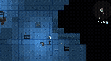
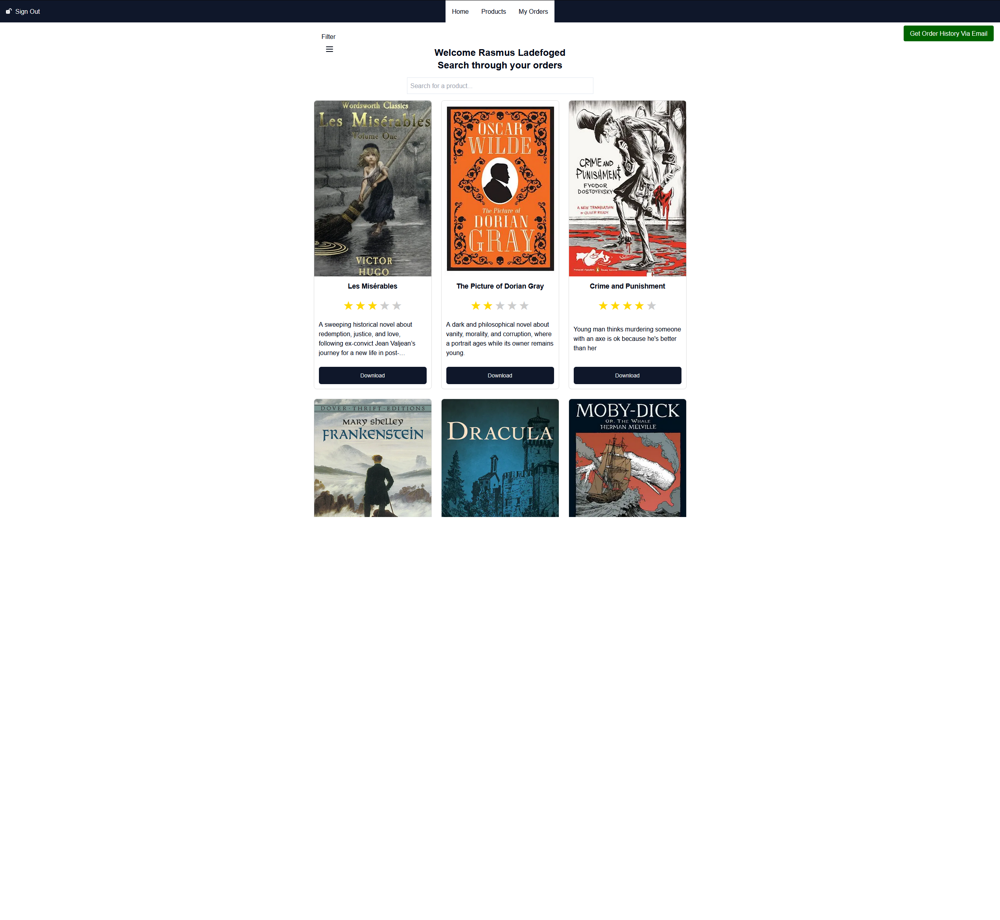
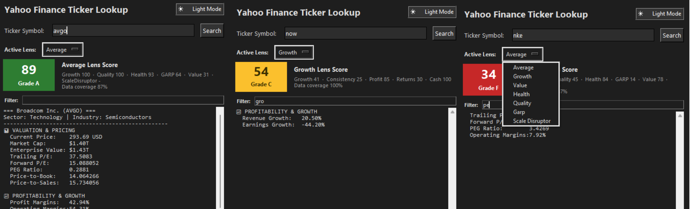
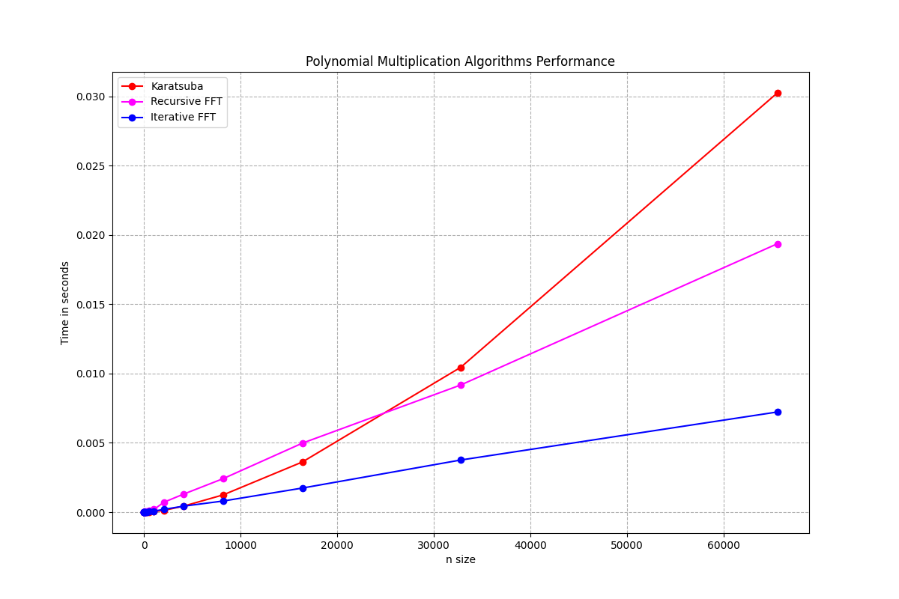
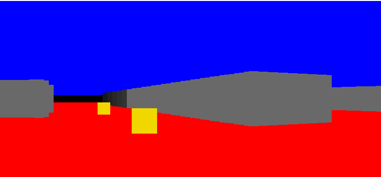

# Rasmus Ladefoged: Software Developer in Copenhagen

I'm a backend-focused developer with a B.Sc. in Computer Science from Copenhagen University, working as a consultant at Netcompany. I like building complete systems and understanding how they work underneath: a .NET web API for a bookstore, a 2D game engine written from scratch, and a stock screener that scores companies from financial data are some of my main projects.

Before development I spent several years in IT support and QA for Microsoft, Google and Apple in Ireland.

📫 [LinkedIn](https://linkedin.com/in/rcarlsen853/) · [Email](mailto:rasmus.lc3@gmail.com)

### 🚀 Current Focus Areas

* **Systems & Algorithmic Thinking:** Developing a complex **2D Dungeon Crawler** from scratch in Python. Rather than relying on a commercial engine, I am building the core mechanics myself—focusing on advanced AI pathfinding, real-time raycasting, and custom spatial partitioning to optimize performance under heavy entity loads.
* **Architecture & Maintainability:** Practicing rigorous software engineering patterns to manage a large-scale codebase as complexity scales. The engine leverages **Component Composition** over deep inheritance hierarchies, separating game state, rendering logic, and physical boundaries into decoupled subsystems. By utilizing patterns like **Data-Driven Factories** for entity spawning and **Lazy Instantiation** for resource management, the architecture minimizes memory overhead and remains highly extensible as new mechanics are introduced.

Below are some of my notable projects, followed by the toolset I use to build them.

---
### ⚔️ **[Custom 2D Dungeon Crawler Engine (Kobold Clash)](https://github.com/RasmusLC1/Kobold_Clash/)** — *Python, Pygame*

A custom-built game engine powering a procedurally generated 2D world with real-time AI, dynamic lighting, and zero external engine dependencies.
* **Load-Balanced AI:** Supports 100+ simultaneous enemies utilizing $A^*$ pathfinding coupled with a frame-distributed request queue to eliminate frame stuttering while maintaining 60+ FPS.
* **Spatial Knowledge Hub:** Designed a centralized tile grid system where tiles cache local boundaries and entities, dropping situational queries down to $O(1)$ complexity.
* **Dynamic AI Director:** Features a systemic difficulty engine ("The Awakening") that monitors player noise and environmental density to dynamically manipulate spawns and traps.
* **Raycasting & Lighting:** Implements a 360° raycasting system for fog-of-war exploration with additive per-source tile lighting, pre-computed ray vectors, and cached tile surfaces to minimise redraws.
* **Automated Testing:** Backed by a pytest suite covering core engine systems including AI pathfinding, tilemap spatial queries, raycasting, status effect interactions, and procedural generation pipelines, using mock architectures to isolate components without requiring a live game instance.
* **Developer Note:** Active development since August 2024 — the git history reflects two years of continuous architectural improvement. Newer systems (enemy AI, lighting, tiles, effects) represent my current design thinking; older systems (inventory, weapons) are due for refactoring and show where the project started.

---
### 💻 **[Bookstore Webshop (Booky)](https://github.com/RasmusLC1/Booky)**: *C#, ASP.NET Core, EF Core, SQLite, TypeScript, Next.js*

A full-stack online bookstore with a custom **ASP.NET Core Web API** backend, migrated from a Next.js/Prisma implementation while keeping the existing frontend working throughout.

* **Architecture:** Layered .NET Web API (controllers, services, EF Core) behind a Next.js frontend. Session checks stay in Next.js, and the API accepts only requests carrying a shared service key.
* **Core Features:** Accounts with Google sign-in, Stripe payments (test mode), password-reset and order-history emails, product reviews, and an admin area for managing products, users and orders.
* **Security:** Purchase-verified download tokens that expire after 24 hours and stream the file without exposing storage URLs, bcrypt password hashing, Zod validation and Upstash rate limiting.
* **Delivery:** Frontend on Vercel, with tests and a GitHub Actions pipeline.

---
### 📈 **[Global Stock Screener & Quantitative Backtesting Engine](https://github.com/RasmusLC1/stock_analysis)** — *Python, Pandas, yfinance, SQLite*

A high-performance quantitative backtesting and screening engine designed to evaluate a global universe (~200+ tickers) across multiple fundamental dimensions to identify secular compounders while filtering out cyclical value traps.
* **Multi-Lens Scoring Architecture:** Deconstructs companies into thematic modular lenses (**Growth, Quality, Health, Value, GARP, and Scale Disruptor**) using standardized `yfinance` data normalization, turning raw metrics into a weighted $0–100$ composite score.
* **Capital-Intensive Calibration:** Fine-tuned financial health metrics—such as adjusting cash buffer scaling to accommodate asset-heavy industrial, pharmaceutical, and compounder business models without issuing false penalties.
* **SQLite Data Caching:** Implements a local relational caching layer (`stock_summaries.db`) to persist fetched financial summaries and accelerate subsequent screening runs without repeatedly hitting external APIs.
* **Rigorous Backtesting Suite:** Features dedicated testing and backtesting scripts that correlate historical model scores with future performance, compute multi-year CAGR metrics, and export historical portfolio valuations to CSV for strategy validation.
* **Interactive Desktop Interface:** Includes a native desktop GUI (`src/gui/`) for visual inspection, card views, and interactive filtering of top-tier global equity candidates.

---
### 🏝️ **[Procedural Town Simulator (Towns-End)](https://github.com/RasmusLC1/townsend/)** — *Godot 4, C#*

A procedurally generated 3D island town-builder built on Godot's GridMap, combining custom terrain generation, coastline-aware biome placement, and a fully decoupled tool-based editing system.
* **Procedural Terrain Generation:** Layered simplex noise combined with a radial falloff mask carves a bounded island silhouette; a dual-cache system (full-column data for cliffs/caves, a dedicated surface-tile index for everything else) keeps ground lookups at $O(1)$ instead of scanning every buried layer.
* **Coastline-Aware Biome Placement:** A multi-source BFS flood-fill computes each land tile's true shortest-path distance to open water, banding sand within a configurable ring thickness — replacing a naive "low elevation = beach" heuristic that misplaced sand in inland valleys.
* **Day/Night Cycle:** Drives Godot's animation system to simulate dynamic lighting and sky color shifts over a configurable real-time day length, exposing a normalized time-of-day interface (with day/night transition signals) for future gameplay and AI systems to react to.
* **Extensible Feature Spawning:** A Template Method-based spawner hierarchy (trees, rocks, plants, crates) shares candidate filtering and placement logic, using per-mesh AABB analysis to ground props correctly regardless of source pivot or scale, instead of hand-tuned offsets per asset.
* **Decoupled Grid Editing Tools:** An `IGridTool` interface lets mouse input (click, drag-select with a live rectangle outline) delegate entirely to swappable tool implementations — the input handler has zero knowledge of what a selection actually does, so new tools (paint, build, bulldoze) require no changes to input code.
* **Future Focus Areas:** The end goal is a town simulator in the vein of *Anno* and *RimWorld* — the project's primary focus going forward is systemic simulation and AI (needs, schedules, resource chains, emergent behavior) rather than further expansion of terrain generation.

---
### 🧮 **[Bachelor Project: Polynomial Multiplication](https://github.com/RasmusLC1/Polynomial-Multiplication)** — *Algorithmic Optimization in C*

Academic research benchmarking five polynomial multiplication algorithms implemented from scratch in C using GMP for arbitrary-precision arithmetic.

* **Algorithms implemented:** Naïve O(n²), DFT, recursive FFT, iterative FFT, and Karatsuba — each with a full forward/inverse transform pipeline and a systematic runtime test harness for direct comparison across input sizes.
* **14x improvement on Karatsuba:** Tuned the base-case threshold through empirical benchmarking to find the crossover point where schoolbook 
  multiplication outperforms the recursive overhead, reducing runtime by 14x over the unoptimised implementation.
* **2.5x improvement on FFT:** Refactored the recursive FFT into an iterative layout using bit-reversal permutation and a single upfront memory allocation passed through the call stack, eliminating per-call malloc overhead and improving cache locality.

---

### 🕹 **[3D Wolfenstein Renderer](https://github.com/RasmusLC1/Wolfenstein-Renderer)** — *C#, .NET*

* **3D Wolfenstein Renderer** — *C#, .NET* — A retro raycaster built in 2023 as the technical predecessor to *Kobold Clash*. 

* **Features:** Implemented $A^*$ pathfinding, raycasting-based fog of war, and a real-time ray-traced shooting system.
* **Architectural Takeaway:** The structural and scaling limitations encountered during this project directly influenced the decision to switch to a strict component-based architecture for *Kobold Clash*.

---
## 🧰 Languages and Tools

  
  
  
  
  
  
  
  
  
  

